# iPod Nano 2 慢应用

十五个跑在 iPod Nano 第二代（[Rockbox](https://www.rockbox.org/) 固件）上的 Lua 小程序。它们几乎不需要你做什么：规则很少，画面跟着真实的时间和季节慢慢变，你只是偶尔路过看一眼。

Fifteen slow, ambient Lua apps for the iPod Nano 2G running Rockbox: a sandpile, a flock of birds, Half Dome in fog, a fire lookout tower, a pottery wheel, a quiet one-hole golf course, a Game of Life whose rules turn with the wheel, a sandbox with turning gravity, a dusk lawn sprinkler, a chess opponent whose thinking you can watch, a tiny turn-based cave crawl, a small farm that grows on real time, Kalah (mancala) with a sowing animation, gomoku whose cursor jumps between the spots worth playing, and a late-night eight-ball table.

| | |
| --- | --- |
| 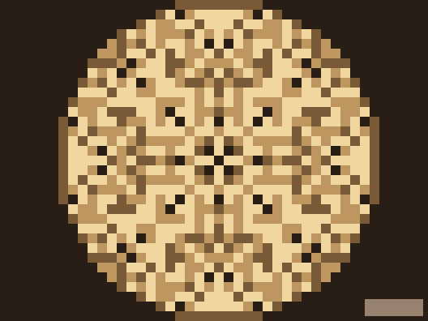 | 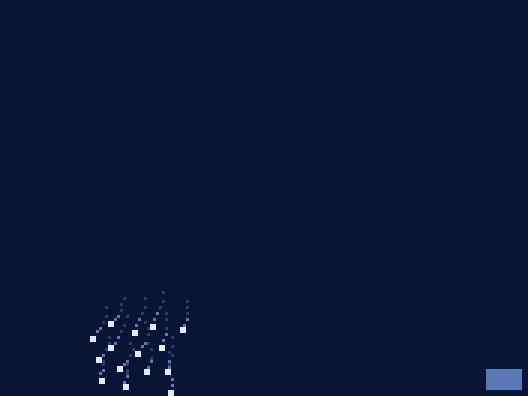 |
| 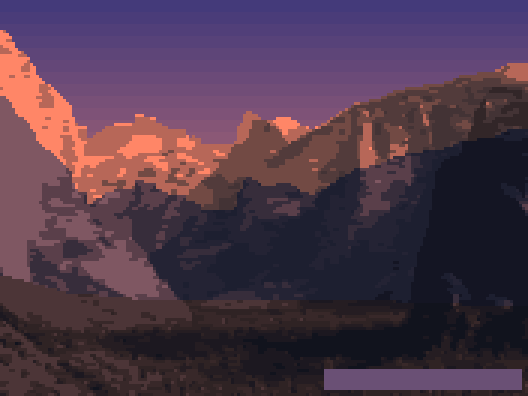 | 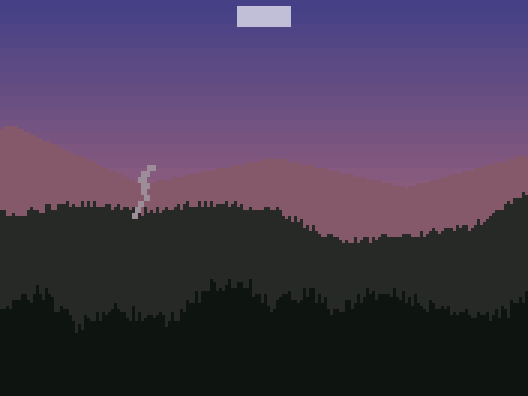 |
| 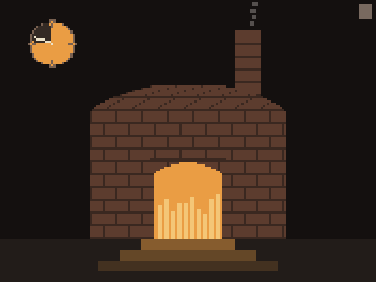 | 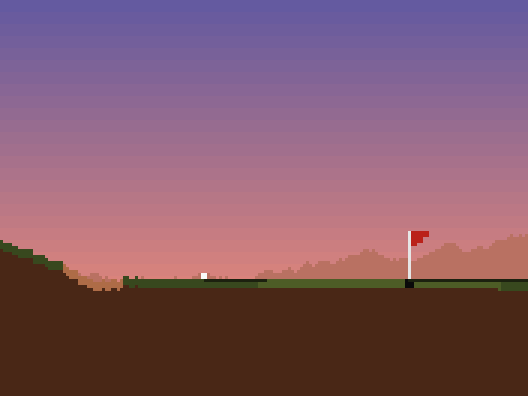 |
| 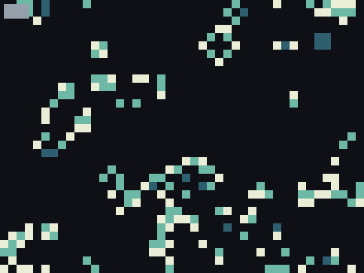 | 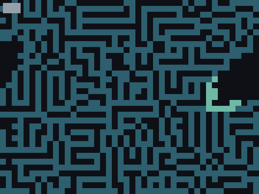 |
| 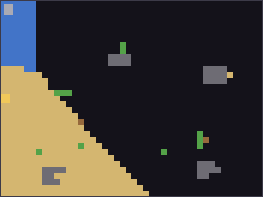 | 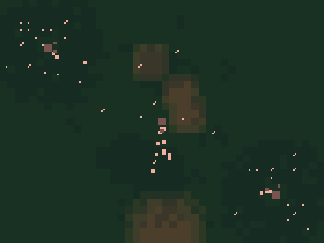 |
| 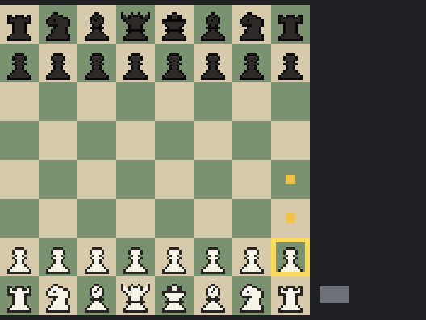 | 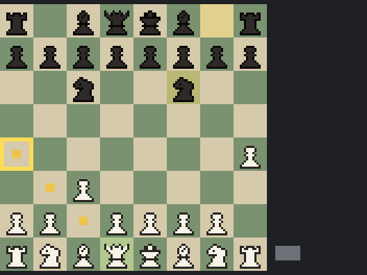 |
| 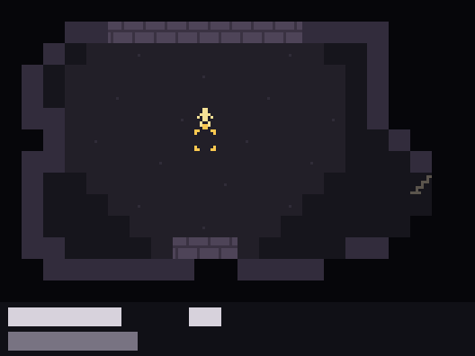 | 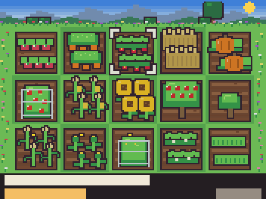 |
| 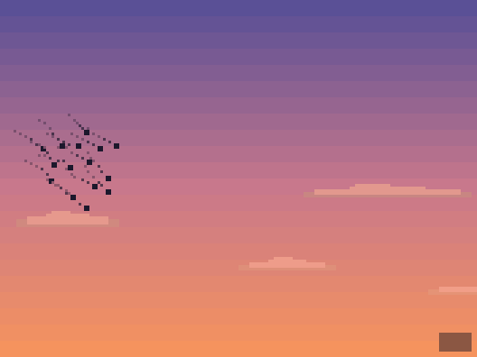 | 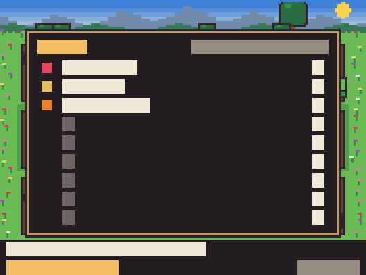 |
| 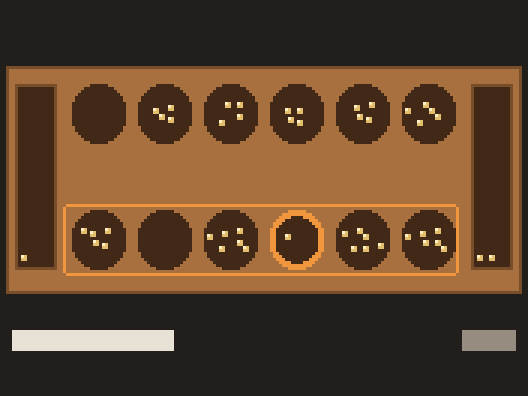 | 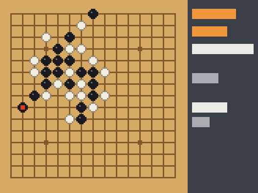 |
| 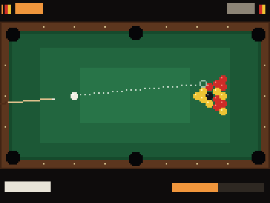 | 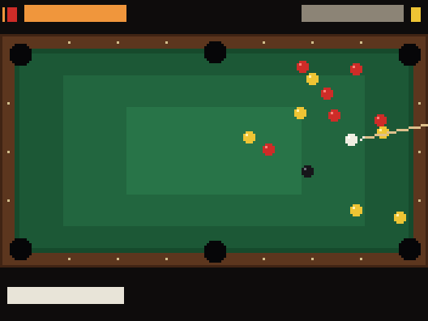 |

完整的设计思路见 [iPod Nano 2 慢应用.md](iPod%20Nano%202%20慢应用.md)。

## 十五个应用

### 沙堆 `sandpile.lua`

一粒一粒落沙，一格满 4 粒就倒塌，四粒沙子分给上下左右四个格子。

- **默认节奏**：一小时一粒，一年 8,760 粒。从中心落，会长出对称的曼陀罗图案。
- **不在场时**：没人看的时候照样落；打开时按经过的时间补算，最多补 20,000 粒。
- **记录**：记下史上最大的一次崩塌，崩了多少格、在哪天。
- **操作**：
  - 转盘：调时间流速，从一天一粒到每秒 30 粒。
  - Select：亲手放一粒。
  - Play：切换中心下落 / 随机下落。
  - 下一首：看最大崩塌的记录。

### 鸟群 `flock.lua`

15 只鸟按 Boids 的三条规则飞：分离、对齐、聚拢。

- **作息**：跟着真实时间。白天飞，傍晚越飞越低，夜里落成一排停在电线上，天亮再起飞。
- **天空**：跟着时间和天气变色。晴天傍晚先是金色，然后是橘粉的晚霞，日落后是紫色的暮光，入夜变成深紫，夜里有星星。每天的晚霞浓淡不一样，地平线上方几条云被照亮。雨天整片天发灰，雾大时地平线发白。白天鸟是深色剪影，夜里是浅色的。
- **掉队**：偶尔有一只离群，在屏幕边缘独自飞一阵，有时回来，有时就不见了。
- **角落数字**：今天整群一共转了多少次弯。
- **操作**：
  - 转盘：时间流速，从每秒 1 帧到 25 帧。
  - Select：惊扰一下，鸟群炸散，再慢慢聚回来。夜里只惊起几只，在电线上方绕一下就落回来；连着按，它们习惯了，飞起来的越来越少，最后只有一只扑腾一下（半分钟忘掉一次）。

### 穹顶与雾霭 `dome.lua`

优胜美地隧道观景台的风景：左边酋长岩，中间远处半穹顶，右边教堂岩，下面是谷底的林子。山体来自真实照片；天空、光和雾按真实时间生成。

- **光**：一天里有黎明灰蓝、清晨冷白、正午平淡、傍晚橘粉、入夜深紫，颜色还按月份微调。日落前后几分钟，山谷已经暗了，只有山顶还亮着。
- **雾**：清晨在谷底生成，扩散、上升，太阳越高蒸发越快。每天的雾形不一样；冬天和雨后更多，偶尔停在半山腰，半穹顶像浮在云上。
- **操作**：
  - 转盘：拨动时间看接下来或刚才的光，无操作后画面慢慢退回现在。
  - Select：藏起 / 显示角落的日期。

### 瞭望塔 `tower.lua`

你在森林火警塔上，转盘就是在塔里转身，360 度环视。全景是 3 层山脊，宽约 4 个屏幕。

- **会发生的事**：远处一缕烟（大约几天一次）、鹿、鸟群、慢慢移过来的暴雨、夜里的星空和远处另一座塔的灯。大部分日子什么都没有。记下来的烟过一阵会散，没被发现的烟可能在山坡上留下一块焦黑，几周后才慢慢返绿。
- **日志**：保存你作为护林员的记录。
- **操作**：
  - 转盘：转身。
  - Select：把眼前看到的东西记进日志，附上时间和方位。
  - 长按 Select：翻日志。

### 陶艺转盘 `pottery.lua`

泥在拉坯机上自己转，双手自己从底往上走，你用转盘把手往里收、往外放。

- **成形**：第一次动转盘或上一首 / 下一首后，双手从底层开始往上走，大约 30 秒走到顶。手一开始在最外面，碰不到泥；转盘把手往里收，收到比泥窄的地方，那一层就被收窄、拔高。不收手，形状就不变。
- **歪掉**：某一层比下面宽出太多（悬出去），泥会慢慢歪掉，算残次品。
- **烧窑**：进窑要真实的一小时，釉色每次随机。左上角的小钟走一圈就烧好了，走过的部分是火色。
- **架子**：烧好的罐子摆上木架子，歪掉的放在最下面一格。
- **操作**：
  - 转盘：顺时针把手往里收，逆时针往外放；看架子时用来横向浏览。
  - 下一首 / 上一首：直接加宽 / 收窄手正经过的那一层。
  - Select 或 Play：送进窑（至少捏过一下才行）。
  - 长按 Select：看架子 / 回来。烧窑时按 Play 也能看架子。

### 高尔夫 `golf.lua`

一座安静的小球场，一天只开放一个洞，第二天换一个新地形。

- **瞄准与出杆**：
  - 慢慢转转盘：调出杆角度，球前面的三个小白点是方向。
  - 快速转一下：出杆，拨得越快力度越大。
- **球场**：
  - 沙坑：球几乎不弹也滚不远。
  - 小溪：掉进去只溅起水花，放回岸边，不罚杆。
  - 果岭：更滑，推杆力度减半；球停在离洞 8 像素以内就算进。
  - 兔子：偶尔坐在果岭边，球滚近了就跑开。
- **光和影子**：跟着真实时间，傍晚影子很长。
- **打完以后**：
  - 左上角出现一个小日历，表示明天再来。
  - 转盘改成左右看整个球场。
  - Select 看一眼杆数。
- **Play**：显示转盘速度读数，用来调手感。

### 规则旋钮 `rules.lua`

一个生命游戏的宇宙，转盘转的不是时间，而是它的物理规则。

- **规则**：26 条，按“相近”排好，相邻两条只差一两个数字。换规则时不清屏，当前的图案直接在新规则下继续演化。
- **颜色**：刚出生的格子亮，活得越久颜色越深。
- **角落数字**：规则编号。规则本身不显示，要看它的行为去认。
- **不在场时**：每 5 分钟走一代，打开时快进补算，最多 600 代。进入循环就直接跳过，角落显示 `loop`。
- **操作**：
  - 转盘：换规则。转动时演化变慢，停住 2 秒后恢复。
  - Select：收藏当前的宇宙，最多 8 个。
  - 长按 Select：在中间撒一把活格子。
  - Play：看收藏。转盘翻页；Select 把这个收藏搬回主宇宙。

### 旋转重力 `gravity.lua`

一个装着沙、水和种子的小盒子，转盘转动重力的方向。

- **材料**：沙往下掉、往斜下滑；水还会往两边流；种子停稳后，3 格内有水就发芽（沙子是湿的）；植物不动，把地形钉住；石头不动。
- **植物**：按真实时间往重力的反方向慢慢长，吸 2 格内的水。整株 3 天没水就枯成沙。
- **角落数字**：盒子里现在有几株植物。
- **静下来以后**：一分钟没动静，会有一粒沙自己松动，引起一小段滑坡。
- **操作**：
  - 转盘：重力转 45 度，共 8 个方向。框上的小方块指着“下”。
  - Select：从上游撒一把，沙、水、种子轮流。
  - 下一首：看活得最久的那株植物活了几天。

### 洒水器 `sprinkler.lua`

俯视一片草地，中间是你的喷头，远处两个自动洒水器自己转（黄昏自动开；你手动开时它们也跟着开）。

- **开放时间**：日落前 30 分钟自动打开，日落后 40 分钟关。其余时间（白天、夜里）都可以按 Play 手动开；黄昏也可以手动关。按 Play 时左上角亮 2 秒的水量刻度，开着是亮的，关着是暗的。
- **喷头**：手指在转盘哪里，水就喷向哪里。转得慢，水落得近、湿得透；转得快，洒得远、只湿一层皮。
- **草地**：湿的格子每 5 分钟干一点。浇透的那天草好一档，两天以上没浇就差一档。下雨天整片草地都算浇过。
- **鸟**：水洼多了，偶尔落下一只鸟喝水；喷头转过去，它就飞走。
- **水的颜色**：跟着天色走，黄昏是橘色的。
- **操作**：
  - 转盘：喷头方向。
  - 上一首 / 下一首：水量小 / 大，共 5 档。换的时候左上角亮 2 秒刻度。
  - Play：开 / 关。

### 国际象棋 `chess.lua`

对手在机器里。它思考时，正在考虑的走法会在棋盘上淡蓝色地一个个闪过。

- **模式**：开局界面选人对人、执白、执黑、电脑对电脑，每种模式记着下了几局、白黑各赢几局。执黑时棋盘倒过来，黑方在下面。开局界面按 Play 也能换思考时间。

- **规则**：完整规则，包括王车易位、吃过路兵、兵升变。三次重复、50 步没动兵也没吃子、只剩王或王加一个轻子，都算和棋。
- **落子提示**：
  - 选子时，光标（蓝框）停在哪颗子上，就预先用橙点标出它所有能走的格子；能吃子的格子标橙色的四个角。
  - 上一步的起点和终点会着色；被将军时，王所在的格子是红的。
- **对手**：搜索 2～3 步，大约初学者水平。输了不认输，只是想得越来越久。
- **右边窄条**：上面是下方一方吃掉的子，下面是上方一方吃掉的子；最下面是思考时间。一局结束后显示结果和这个模式里“白赢-黑赢”的局数。
- **操作**：
  - 选子：转盘在能动的棋子之间跳，Select 选中。
  - 落子：转盘在合法落点之间跳，Select 落子，Menu 退回选子。兵到底线时，再用转盘选升变成什么。
  - 上一首：悔棋。人对人退一步；人对电脑退回到上一次轮到你的时候。新开一局时，角落会写上一局悔了几步。
  - Play：思考时间 3 / 10 / 30 秒。
  - 电脑对电脑：两边都由它下，你只看它们思考。按 Play 切换每步至少隔 5 / 10 / 20 秒，默认 10 秒，窄条上显示 `auto 10s`。一局结束就停在终局（窄条上写着 `sel:new`），按 Select 开下一局。
  - 一局结束后，Select 回开局界面（观战时直接开下一局）。
  - 长按 Select：回开局界面。
  - 选子时按 Menu 退出。

### 地下城 `dungeon.lua`

一个很小的 roguelike。每一层是用元胞自动机长出来的洞穴，回合制：你走一步，怪物各走一步；你不动，世界就不动。

- **视野**：只看得见视线内大约 6 格；走过的地方暗着留在地图上。
- **怪物**：
  - rat：看见你就追；打斗的声音会把附近的 rat 引过来；身边有 moth 时先去吃 moth。
  - moth：怕光，在你视野里就逃，离你两格以内跑得更快。被逼到角落才咬人。
  - shade：只在你停下（原地等、打架、用道具）时才靠近。
  - newt：只是路过，打它没有任何好处。
- **道具**：potion 回 5 点血，lamp 照亮整层，charm 让视野里离你最近的那种怪物 30 回合不理你。
- **墓碑**：你死在哪一层，就在那一层留下一块写着死因的墓碑。以后每一局走到同一层，有一半的机会碰到它。
- **记录**：走到过的最深一层，以及墓碑。没有分数，也没有通关。
- **操作**：
  - 转盘：转动角色周围的箭头（8 个方向），目标格四角亮起，底栏写着会发生什么，比如 `> attack rat`。
  - Select：执行，可能是走过去、攻击、下楼或捡起。
  - 长按 Select：原地等一回合。
  - Play：道具栏，转盘选，Select 用，Menu 关。
  - 随时退出，地下城停在原地等你回来。

### 小农场 `farm.lua`

5×3 块地，作物按真实时间生长。一共 9 种：萝卜 4 小时、胡萝卜 8 小时、麦子 1 天、番茄和草莓 2 天、玉米 3 天、南瓜 4 天、向日葵 5 天、苹果树 3 周。苹果、番茄、草莓收了还会再结。

- **画面**：伪 3D 的像素风，颜色鲜亮。草地上一块块翻过的田（亮的田垄、暗的垄沟、前面露出一截土）。顶上一条远景：跟着时间和天气变色的天空、两层远山、一棵树和几丛灌木，田四周的草地开着红、紫、粉色的野花；黄昏时天空是紫色的。时间在底栏右下角。作物铺满整块方田：萝卜、胡萝卜、草莓、麦子、南瓜种前后两行，玉米和向日葵是 2×2，番茄是套着铁丝笼的一大丛，苹果是一棵大树；后排先画，前排压在上面，看得出前后。作物和小动物都描了深色边。颜色跟着真实的光走，傍晚发暖，夜里变暗。
- **一个键全包**：Select 对光标所在的地做“下一件该做的事”：拔草、翻地、播种、浇水、收获。底栏写着作物、还要多久，和下一件事。
- **天气**：下雨天地自己湿，晴天慢慢干。干了的地停止生长，但不会死。
- **不来的时候**：打开时按离开的小时数补算，最多 60 天。熟了没收的作物过一天会落种，在自己和旁边的空地上重新发芽；杂草从荒地和长草的地块慢慢蔓延，几天多一块。很久不来，农场会长成一片野地，回来先拔草。
- **乌鸦**：有熟的作物时，偶尔落在那块地的篱笆上坐一两分钟。光标移过去按 Select 赶走它，不然它叼走一颗。
- **蜜蜂和新品种**：相邻两种作物同时开花，能看到蜜蜂在中间飞。收获时有机会得到颜色介于两者之间的新品种种子，种子袋里带 `*`。
- **没有金币和商店**：种子只从自己的收成里来，第一次打开时送萝卜、麦子、南瓜、苹果的种子起步。没见过的作物靠“捡”：路过的兔子和刺猬偶尔身上沾着一粒种子，不在的时候也偶尔有种子被风吹来，在空地上自己发芽，平均四天一次，优先是还没见过的作物。
- **小动物**：只在你看着的时候偶尔路过，一次最多一只。白天的兔子（大约四十分钟一只）路过熟了的萝卜、胡萝卜、草莓会啃掉一颗，光标移到它那块地它就跑；雨天有青蛙跳过，夜里有刺猬慢慢走过，有花开时蝴蝶在田里飘。
- **谷仓**：种子袋里按下一首翻到谷仓页，列出 9 种作物各收过多少，没见过的作物是问号。
- **操作**：
  - 转盘：光标在 15 块地之间按蛇形顺序移动。
  - Select：下一件该做的事。
  - Play：种子袋，转盘选，Select 定；下一首 / 上一首切到谷仓页。

### 播棋 `mancala.lua`

卡拉哈规则的播棋：每方 6 个坑，开局每坑 4 颗。拿起一坑，逆时针一颗一颗撒；最后一颗进自己的仓就再走一次，落进自己一侧的空坑就把对面的种子一起收走。一侧空了游戏结束，仓里多的赢。

- **模式**：开局界面用转盘选人对人、人对电脑、电脑对电脑，每种模式下面写着下了几局、各方赢了几局，最下面是“最多一次连走了几步”的记录。
- **画面**：木头棋盘，两排圆坑，两头是长条的大仓，种子是带一点高光的小点。一坑超过 12 颗只画一堆，数字写在坑旁边。该走的一侧被一圈细橙框正好围住，底栏右边是两个仓的数（左仓:右仓）。
- **撒种动画**：一颗一颗落，看得清楚每一颗去了哪；吃子和终局时停一下。不能跳过。
- **电脑**：负极大值搜索加剪枝，按“仓里的差距”打分，最多看 9 层（观战时 7 层），打平时随机挑一个，所以电脑对电脑每局都不一样。想的时候，它考虑过的坑轮流亮一下。
- **操作**：
  - 转盘：在该走一方的非空坑之间跳（橙色圆圈），Select 撒种。选不到不合法的坑。
  - 上一首：悔一步，退回到上一次轮到你的时候（人对电脑）。
  - 观战时 Play：每步至少隔 5 / 10 / 20 秒，默认 10 秒。一局结束停在终局，Select 开下一局。
  - 长按 Select：回开局界面。

### 五子棋 `gomoku.lua`

15×15 的棋盘，黑先，连成五子赢；下满算和棋。

- **模式**：开局界面选人对人、执黑、执白、电脑对电脑，每种模式记着下了几局、黑白各赢几局。
- **跳点**：转盘不在格子之间爬，而是在已有棋子两格以内的空位之间跳。要紧的点（能连成三、四，或者要堵对方的）排在最前，其余从最后一手开始由近到远。
- **自由光标**：Play 切换。转盘在一行里左右走，上一首 / 下一首换行，能下到任何地方。
- **电脑**：按棋形打分（活四、冲四、活三、双三、四三……），进攻和防守一起算；再把前 6 个点各试下一下，看对方接下来最好能得几分，减掉。每步至少想 1.5 秒，它在试的点会在棋盘上淡淡地浮现。
- **禁手**：默认不加。在说明页按 Play 打开黑方禁手：双三、双四、长连都不能下（只看一层，不追究“假禁手”），开着时窄条上写 `limits`。
- **画面**：每格 8 像素，棋盘在左边，最后一手有个红点。右边窄条写着该谁下、手数、模式和光标方式。连成五子时那一条线闪几下。
- **操作**：
  - Select：落子。禁手点会提示 `no!`。
  - 按住上一首：悔一步（人对电脑）。
  - 观战时 Play：每步至少隔 5 / 10 / 20 秒。一局结束停在终局，按 Select 开下一局；一分钟没人按就自己开下一局，可以放一整晚。
  - 长按 Select：回开局界面。

### 台球 `pool.lua`

一张小小的八球台，深夜台球厅的感觉：一盏灯照在绿色台呢中间，周围暗下去，球滚得比真的慢一点。

- **模式**：开局界面选人对人、人对电脑、电脑对电脑，每种模式记着下了几局、两边各赢几局、一杆连续打进最多几颗球。
- **规则**：7 颗红球、7 颗黄球、1 颗黑球。开球后第一颗合法打进的球决定你是红组还是黄组；清完自己一组再打进黑球就赢，提前打进黑球就输（开球时打进黑球放回置球点）。白球落袋、什么都没碰到、先碰到的不是自己组的球都算犯规，对方拿到自由球。没有指定袋口。
- **画面**：顶上一条写着两方和各自的组还剩几颗，该打的一方是橘色。瞄准时一条虚线画到第一次碰撞，碰到球的地方画一个空心的假想球；不画碰撞之后的走向。
- **电脑**：对每颗能打的球、每个袋口算出假想球的位置，角度太偏或路上有球挡着的扔掉，剩下的每个试两种力度，用同一套物理把整杆模拟一遍，挑打进自己组的球、不犯规、白球停得好的那一杆，再加一点手抖。试的时候球杆跟着在几个角度之间比划；偶尔先擦一下巧粉（杆头变蓝）。上一杆打丢了，这一杆想得更久。
- **操作**：
  - 瞄准：转盘让球杆绕着白球转，慢转一格约 0.35 度，转得快步子就大。Select 确认方向。
  - 力度：逆时针拉杆加力，顺时针减力，底下的力度条跟着变。Select 出杆，Menu 退回瞄准。
  - 自由球（和开球前）：转盘把白球沿开球线上下移动，Select 放下。
  - 上一首：悔一杆（人对电脑）。
  - 观战时 Play：每杆至少隔 5 / 10 / 20 秒。一局结束停在终局，按 Select 开下一局；一分钟没人按就自己开下一局。
  - 长按 Select：回开局界面。

所有应用都是短按 Menu 退出（松手时退出），进度自动保存。**长按 Menu** 打开这个应用的说明页：一段介绍和所有按键的用法，转盘上下翻，按任意键关掉。

## 安装

需要一台装了 Rockbox 的 iPod Nano 第二代。

1. 把 [dist/](dist/) 里的 `.lua` 文件拷到 iPod 上任意文件夹，比如 `/Slow/`。
2. 在 Rockbox 的文件浏览器里选中 `.lua` 文件就能打开。

存档写在 `/.rockbox/rocks.data/slow_*.txt`。

在 Mac 上开发时，插上 iPod 运行 `./tools/deploy.sh`，会打包、拷进 `/Slow/`，然后自动推出 iPod。

## 开发

```sh
./tools/build.sh                      # 打包到 dist/，并检查 Rockbox Lua 的限制
lua test/run.lua dist/golf.lua 300 0 "fwd*5,flick*3,select"   # 在桌面上的假 Rockbox 里跑（按键还有 longselect、longmenu、longprev）
lua test/chess_perft.lua              # 象棋引擎：perft 走法数和几个战术局面
tools/snap.sh dist/dome.lua 40 0 "" dome   # 跑 40 帧，把画面存成 PNG
./tools/deploy.sh [--no-eject] [文件夹]    # 打包、拷进 iPod、推出
./tools/yosemite.sh                   # 从照片重新生成穹顶的场景（照片在 no_upload/，不在仓库里）
```

- 需要桌面上装 `lua` 和 `luac`（Homebrew 的 `lua` 就行）。
- 生成场景还需要 macOS 自带的 `sips`。

| 路径 | 内容 |
| --- | --- |
| `src/common.lua` | 共用部分：整数数学、时间、存档、按键与转盘速度、背光，以及穹顶、瞭望塔、高尔夫共用的光和天气 |
| `src/<应用>.lua` | 各个应用 |
| `src/data/dome.lua` | 由照片生成的穹顶场景数据 |
| `dist/` | 打包好的单文件脚本，可以直接拷进 iPod |
| `test/run.lua` | 桌面上的假 Rockbox：检查运行时错误、整数、按键退出，还能截图 |
| `tools/` | 打包、限制检查、部署、截图、照片转换 |
| `screenshots/` | 测试环境里截的画面，放大 3 倍 |

给 AI 助手或新接手的人看的技术备忘在 [Agent.md](Agent.md)：Rockbox Lua 的各种坑、上机实测的数字、设计约定。

## 素材

穹顶的山体来自优胜美地隧道观景台的延时照片。原始照片放在 `no_upload/`，不进仓库；仓库里只有处理后的 176×132 轮廓和明暗档位。
